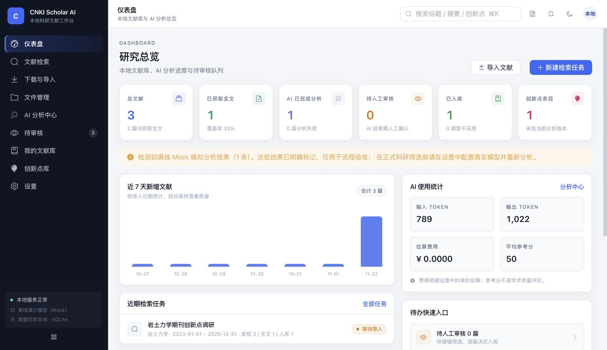
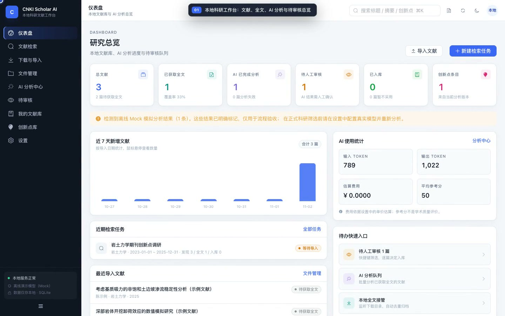
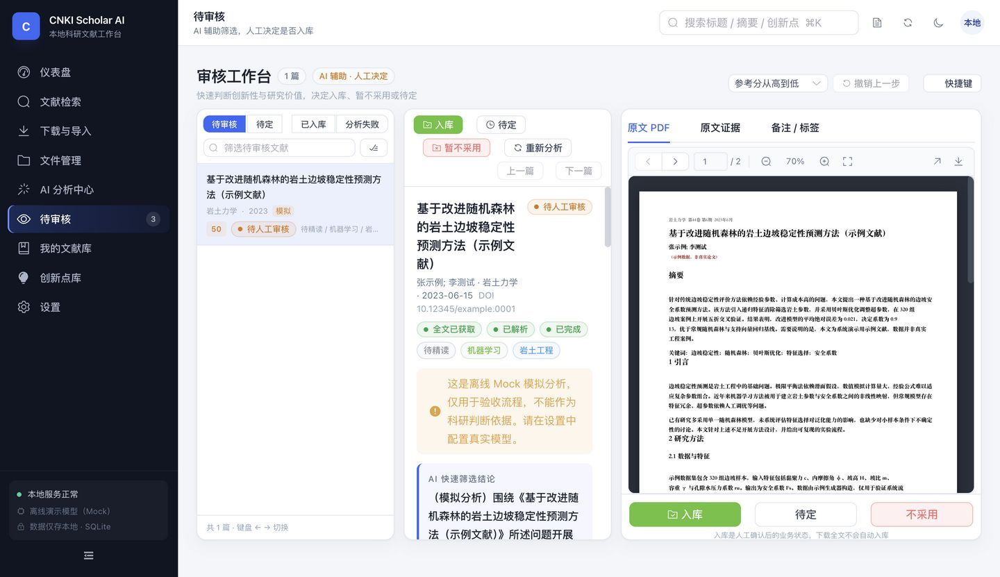
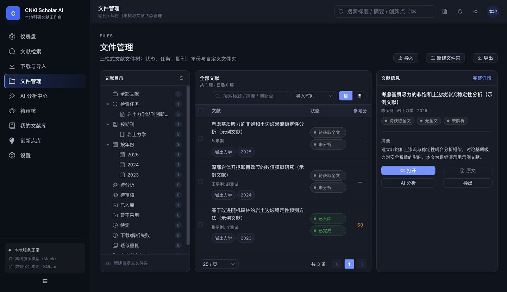
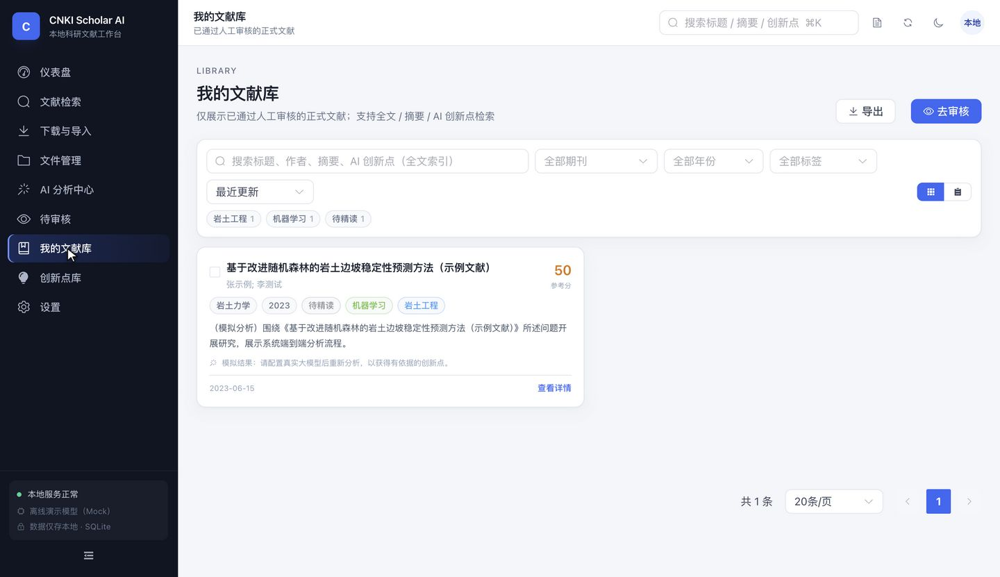
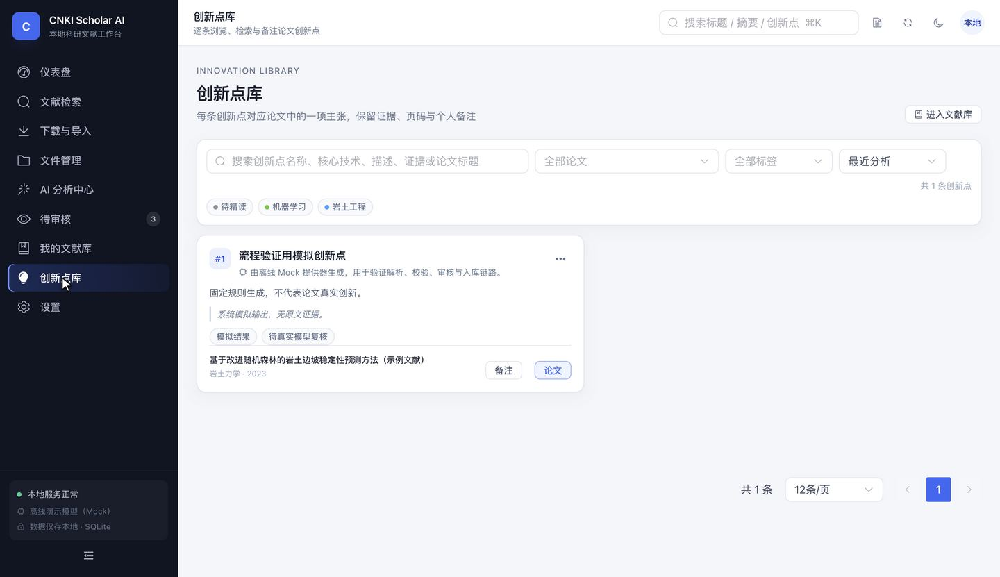
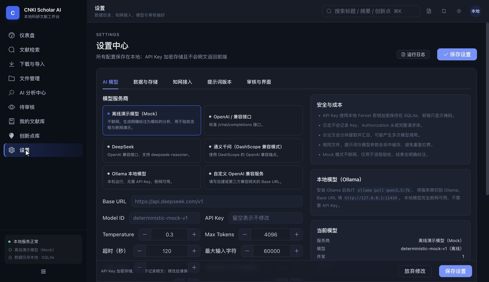
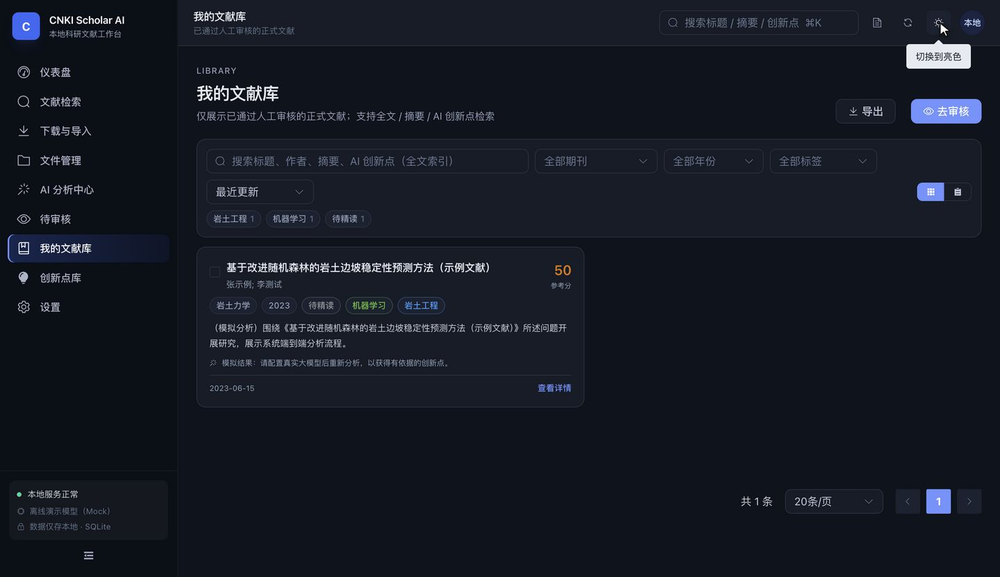

# CNKI Scholar AI

**本地优先的科研文献管理与 AI 创新点筛选系统**

一套可运行的个人科研工作台：从检索任务、官方题录导入、本地全文接管，到 PDF 解析、LLM 结构化分析、人工审核入库、全文 / 创新点检索与导出，形成完整闭环。所有文献、分析记录和审核结果都保存在本地 SQLite 与用户指定目录中，断网后已有文献仍可管理阅读。

> 本项目不包含任何逆向知网私有接口、验证码绕过、伪造认证或规避访问限制的实现。知网相关功能只支持：官方页面手工检索、官方题录文件导入、用户合法下载的本地全文接管，以及预留的**经单独书面许可**的数据接口适配器。演示数据全部明确标注为示例，不冒充实时知网结果。



**🎬 操作演示视频（74 秒）**

[](docs/demo/cnki-scholar-ai-demo.mp4)

[查看或下载 MP4](docs/demo/cnki-scholar-ai-demo.mp4) · [WebM 源文件](docs/demo/cnki-scholar-ai-demo.webm)  
覆盖：检索条件单 → 题录/全文导入 → 文件管理 → AI 分析 → 人工审核入库 → 文献库全文检索 → PDF 阅读 → 创新点库 → 设置与主题。视频中的 Mock 分析已明确标注为模拟。

---

## 目录

- [当前实现状态](#当前实现状态)
- [核心能力](#核心能力)
- [快速开始](#快速开始)
- [验收场景复现](#验收场景复现)
- [系统架构](#系统架构)
- [数据与备份](#数据与备份)
- [知网接入边界](#知网接入边界)
- [AI 分析与质量控制](#ai-分析与质量控制)
- [设置说明](#设置说明)
- [API 与测试](#api-与测试)
- [Windows EXE 路线](#windows-exe-路线)
- [项目结构](#项目结构)
- [已知限制](#已知限制)
- [安全与隐私](#安全与隐私)

---

## 当前实现状态

| 模块 | 状态 | 说明 |
| --- | --- | --- |
| FastAPI + SQLite + Alembic | ✅ 已实现 | 19 张业务表、WAL、外键、索引、初始迁移与 FTS5 trigram 索引 |
| Vue 3 工作台 | ✅ 已实现 | 9 个主页面、亮/暗主题、Element Plus + Tailwind、响应式三栏布局 |
| 检索任务 | ✅ 已实现 | 期刊来源与主题严格区分、完整日期校验、条件单、暂停/继续/取消/重试、日志、计数 |
| 题录导入 | ✅ 已实现 | RIS / BibTeX / EndNote ENW / CSV；按期刊与日期过滤；保留日期精度 |
| 本地全文接管 | ✅ 已实现 | 上传、拖拽、目录扫描、Watchdog 监听、期刊/年份归档、SHA-256 去重 |
| 去重 | ✅ 已实现 | DOI / 规范化标题+作者+年份 / SHA-256 三层；疑似重复提示人工确认，不自动删除 |
| PDF 解析 | ✅ 已实现 | PyMuPDF 主解析 + pdfplumber 兜底；页映射、章节定位、扫描/加密文件诚实标记 |
| CAJ | ⚠️ 保留原文件 | 不内置解析器，明确标记“未解析”，可导入有权转换的 PDF |
| AI Provider | ✅ 已实现 | OpenAI 兼容、DeepSeek、通义千问、Ollama、离线 Mock；统一适配器 |
| 结构化分析 | ✅ 已实现 | 严格 Pydantic Schema、有限次修复、分块+分层汇总、页码约束、缓存、Token/费用 |
| 人工审核 | ✅ 已实现 | 入库/暂不采用/待定/撤销、批量、快捷键、标签、备注、审计历史 |
| 正式文献库 | ✅ 已实现 | FTS5 全文/摘要/创新点检索、期刊/年份/标签筛选、卡片/表格视图 |
| 创新点库 | ✅ 已实现 | 逐条创新点、证据、页码、个人备注、复制 Markdown、按论文/标签筛选 |
| 导出 | ✅ 已实现 | CSV / Excel / JSON / Markdown / RIS / BibTeX / 笔记 Markdown；不默认打包全文 |
| 持久化任务队列 | ✅ 已实现 | SQLite 队列、并发限制、重试、取消、进程重启恢复、去重键防重复 AI 调用 |
| 自动备份 | ✅ 已实现 | 可开启；启动与每小时检查，24 小时内不重复；zip 含数据库+元数据+AI 结果 |
| 知网授权 API 适配器 | ⚠️ 预留骨架 | 未获得官方接口文档与许可前不内置任何端点，调用会明确拒绝 |
| Windows EXE | ⚠️ 方案预留 | 前后端 HTTP 解耦，已提供 PyInstaller + Electron sidecar 技术方案，未生成安装包 |
| 用户登录 / 多用户 | ❌ 不在 MVP | 单用户本地系统，监听 127.0.0.1 |

---

## 核心能力

### 检索任务不是“关键词搜索”

用户输入的 **“文献来源 / 期刊名称”** 是硬过滤条件，不会被当作主题关键词。系统生成的检索条件单明确区分：

- 文献来源：`岩土力学`
- 主题关键词：`（未限定主题）`
- 发表时间：`2023-01-01 ~ 2025-12-31`
- 文献类型：期刊论文

导入题录时，后端会核对期刊、日期和关键词，只把符合任务条件的记录关联到任务，并在导入明细中列出跳过原因。

### 全流程可追溯

```
检索任务 → 题录/全文 → 文件归档 → PDF 解析 → AI 分析 → 人工审核 → 正式文献库 → 创新点库
```

每一步都有独立状态字段，绝不混用：

- `fulltext_status`：元数据是否已有全文
- `parse_status`：PDF 是否解析成功
- `ai_status`：AI 是否完成
- `review_status`：人工审核业务状态

**下载全文不会自动入库，AI 完成也不会自动入库。** 只有用户在审核工作台点击“入库”才会进入正式文献库。

### 离线 Mock 模式

首次运行默认使用离线 Mock 模型，便于在没有任何 API Key 的情况下验收完整流程。所有 Mock 结果都带有 `is_mock=true`，界面显示醒目的“模拟分析”提示，并写入 `data/ai_results/`。配置真实模型后可一键重新分析。

---

## 快速开始

### 环境要求

- Python **3.11+**（推荐 3.12）
- Node.js **20+** 与 npm
- macOS / Linux / Windows
- 无数据库服务依赖（SQLite 内嵌）

### macOS / Linux 一键启动

```bash
cd 知网系统
./scripts/setup.sh      # 创建 .venv、安装依赖、构建前端、初始化数据库
./scripts/start.sh      # 启动 http://127.0.0.1:8000
```

或自动打开浏览器：

```bash
OPEN_BROWSER=1 ./scripts/start.sh
```

### Windows 一键启动

双击 `scripts\start.bat`，或在命令行执行：

```bat
scripts\start.bat
```

### 开发模式（前后端热更新）

```bash
./scripts/dev.sh
# 前端 http://127.0.0.1:5173
# 后端 http://127.0.0.1:8000  (API 文档 /docs)
```

### 手动启动

```bash
cp .env.example .env
python3.12 -m venv .venv
source .venv/bin/activate
pip install -e ".[dev]"
cd frontend && npm install && npm run build && cd ..
python -m uvicorn app.main:app --app-dir backend --host 127.0.0.1 --port 8000
```

打开 `http://127.0.0.1:8000`。API 文档：`http://127.0.0.1:8000/docs`。

### 默认数据目录

```
data/
  database/cnki_scholar.db
  papers/{期刊}/{年份}/
  imports/
  metadata/
  ai_results/
  exports/
  backups/
  logs/
  temp/
  keys/master.key       # 0600 权限；用于加密 API Key
```

修改 `.env` 中的 `CNKI_DATA_DIR` 为绝对路径，即可把整个库放到移动硬盘或指定目录。迁移时连同 `data/` 一起复制即可。

---

## 验收场景复现

示例文件：

- `examples/sample_metadata.ris`：5 条题录，其中 3 条符合“岩土力学 + 2023-2025”，1 条期刊不匹配，1 条年份超范围。
- `examples/sample_papers/2023_岩土边坡稳定性预测_张示例.pdf`：**明确标注“示例数据，非真实论文”** 的可解析 PDF。

步骤：

1. 打开系统 → “文献检索” → 新建任务：
   - 名称：岩土力学期刊创新点调研
   - 期刊来源：岩土力学
   - 主题关键词：留空
   - 起始 2023-01-01，截止 2025-12-31
   - 文献类型：期刊论文
2. 打开任务详情 → “生成条件单 / 启动”。
3. 点击“导入官方题录”，选择 `examples/sample_metadata.ris`。
   - 预期：导入 3，跳过 2。
4. 点击“扫描导入目录”或到“下载与导入”拖入示例 PDF。
   - 预期：标题与既有题录匹配，全文合并到同一条记录，不产生重复论文。
5. 系统自动排队解析 PDF 并调用 Mock 模型分析。
6. 打开“待审核”，查看摘要、研究方法、创新点、证据与参考分。
7. 点击“入库”，可加标签与审核备注。
8. “我的文献库”按标题/摘要/创新点搜索；“创新点库”按关键词检索。
9. 重启服务后，所有文件、状态、AI 结果与审核记录保持不变。

自动化测试覆盖同一流程，见 `backend/tests/test_api_workflow.py`。

### 界面

| 审核工作台（PDF 与证据联动） | 文件管理 |
| --- | --- |
|  |  |

| 我的文献库 | 创新点库 |
| --- | --- |
|  |  |

| 设置中心 | 暗色主题 |
| --- | --- |
|  |  |

---

## 系统架构

```
Vue 3 + TS + Vite + Element Plus + Pinia + PDF.js
                     │  HTTP / JSON
                     ▼
              FastAPI (Python 3.11+)
   ┌─────────────────┼──────────────────┐
   │                 │                  │
SQLAlchemy 2      Service layer     Persistent job runner
SQLite WAL        providers/adapters  (SQLite queue)
   │                 │                  │
   └──── data/ (本地文件、PDF、JSON 快照、备份、日志) ────┘
```

- 前后端仅通过标准 HTTP API 通信，便于第二阶段的 Electron + Python sidecar 打包。
- 长任务不依赖 FastAPI `BackgroundTasks`：所有任务写入 `background_jobs` 表，由持久化 worker 领取，支持重启恢复、重试与取消。
- AI 调用有独立并发限制、超时与缓存键（文件内容 + 提示词版本 + Provider + 模型 + 温度 + 最大 Token）。
- 文献状态四字段分离，任何阶段都不会自动把文献标为“已入库”。

更详细的设计说明见 [`docs/ARCHITECTURE.md`](docs/ARCHITECTURE.md)。

---

## 数据与备份

- **数据库**：SQLite，WAL 模式，`busy_timeout=30s`，外键开启。
- **迁移**：Alembic 初始迁移 `backend/alembic/versions/de955d910552_initial_schema.py`，包含全部表与 FTS5 索引。

```bash
# 在全新数据库上执行迁移（可选，应用启动也会自动建表）
CNKI_DATA_DIR=/path/to/data .venv/bin/alembic -c backend/alembic.ini upgrade head
```

- **备份**：设置 → 数据与存储 → “立即备份数据库”。zip 内含数据库快照、`metadata/*.json`、`ai_results/*.json`、manifest，不包含受版权保护的 PDF 全文。
- **自动备份**：开启后启动时与每小时检查，24 小时内最多一次。
- **全文索引**：FTS5 trigram，支持中文子串检索；可在设置或 `/api/system/reindex` 重建。

---

## 知网接入边界

系统实现三种模式：

### 模式一：官方检索 + 题录导入（默认，可用）

1. 系统生成检索条件单，告知在知网官方高级检索中如何填写“文献来源”和“主题”。
2. 用户在官方页面检索，使用官方“导出/参考文献”功能导出 RIS / BibTeX / EndNote。
3. 系统导入题录，按任务条件过滤并去重。

不会自动登录知网、不会绕过验证码、不会猜测私有接口地址。

### 模式二：本地全文接管（可用）

- 监听用户指定目录，自动发现 PDF/CAJ。
- SHA-256 去重；标题/作者/年份匹配题录。
- 自动重命名并归档到 `papers/{期刊}/{年份}/`。
- 支持拖拽、上传、批量目录扫描与重新扫描。

### 模式三：经单独授权的数据接口（预留）

`backend/app/adapters/cnki.py` 中的 `CNKIAuthorizedAdapter` 只有在配置了 Base URL、许可编号并启用后才会尝试工作；**当前版本没有内置任何未经确认的知网端点**，调用会返回明确的配置/许可错误。若你拥有官方文档和书面许可，可在该适配器中实现分页、限额、断点恢复和重试。

---

## AI 分析与质量控制

- 统一 Provider Adapter：`openai_compatible`、`ollama`、`mock`。
- API Key 使用本地 Fernet 密钥加密，前端只显示掩码；日志不记录 Authorization 头。
- 提示词版本化：修改内容创建新版本，历史结果保留生成时的 `prompt_version`。
- 严格 JSON Schema（Pydantic）：类型、长度、分数范围、必填字段校验；失败最多修复 2 次，不无限重试。
- 长论文按页分块提取，再与摘要汇总；每条创新点可附页码与短引文。
- 仅摘要分析会强制标记 `analysis_scope=abstract` 并写入“仅基于摘要分析”。
- 不编造实验数值；没有数值时输出“未明确说明”。
- 同一文件/提示词/模型参数命中缓存；重新分析会生成新版本并保留旧版本。
- 人工编辑保存 `original_result` 快照，界面标记“人工已编辑”。

支持的输出字段：`one_sentence_summary`、`research_problem`、`main_method`、`claimed_innovations`、`inferred_contributions`、`innovation_summary`、`key_results`、`research_value`、`limitations`、`screening_score`、`screening_reason`、`evidence`、`analysis_scope`、`missing_information`。

---

## 设置说明

### AI 设置

- 服务商、Base URL、Model ID、API Key、Temperature、Max Tokens、超时、最大输入长度、并发数、推理强度。
- 成本单价（元 / 1K tokens），用于估算费用。
- 自动分析新全文开关。
- 提示词选择与版本管理。

### 数据设置

- 数据根目录（只读展示，通过环境变量修改）
- 导入/监听目录
- 自动目录监听
- 文件命名规则：`{year}_{title}_{first_author}`
- 自动备份

### 审核设置

- 默认排序
- 快捷键（可自定义，例如 `Ctrl+Enter`、`Alt+I`）
- 标签模板管理
- 主题切换

### 知网设置

- 官方入口
- 授权接口预留配置
- 本地全文导入目录
- 适配器状态与合规提示

---

## API 与测试

- 交互式文档：`/docs`
- OpenAPI JSON：`/docs/openapi.json`，离线副本 [`docs/openapi.json`](docs/openapi.json)
- 统一响应：

```json
{ "success": true, "data": {}, "message": null }
{ "success": false, "error": { "code": "validation_error", "message": "…", "detail": {} } }
```

### 测试

```bash
.venv/bin/python -m pytest backend/tests -q
```

当前 **48 项测试全部通过**，覆盖：

- RIS / BibTeX / EndNote / CSV 解析与日期精度
- DOI / 标题 / SHA-256 / 模糊重复
- PDF 页映射、章节识别、CAJ 与损坏文件
- Mock 分析、缓存、强制重分析、摘要范围、JSON 修复上限
- 完整 API 流程：任务 → 题录过滤 → PDF 合并 → 解析 → AI → 审核 → 文库 → 创新点
- 撤销审核后的任务计数回归
- 任务中断恢复、去重入队、CSV/JSON/XLSX/RIS 导出、备份
- 详见 [`docs/TESTING.md`](docs/TESTING.md)

浏览器端到端测试（需先启动服务；使用本机 Chrome）：

```bash
cd frontend
npx playwright test
```

5 项 E2E 覆盖九个主页面、审核入库、PDF 渲染与文本层、设置中心、主题持久化。

前端构建：

```bash
cd frontend
npm run build
npm run typecheck
```

---

## Windows EXE 路线

第一阶段保持前后端 HTTP 解耦，第二阶段推荐：

```
Electron 主进程
  ├─ 启动 PyInstaller 打包的 FastAPI sidecar（127.0.0.1 随机端口）
  ├─ 等待 /api/health 就绪
  ├─ 加载内置 Vue 构建产物
  └─ 退出时优雅终止 sidecar
```

- 数据目录通过 Electron 向导选择，写入 `CNKI_DATA_DIR`。
- PyInstaller 需收集 `pymupdf`、`pdfplumber`、`alembic`、`uvicorn`、`watchdog` 的隐式依赖。
- 详细步骤、打包命令、故障排查见 [`docs/WINDOWS_PACKAGING.md`](docs/WINDOWS_PACKAGING.md)。

---

## 项目结构

```
知网系统/
├─ backend/
│  ├─ app/
│  │  ├─ api/           # 路由与统一响应
│  │  ├─ models/        # SQLAlchemy 模型（19 表）
│  │  ├─ schemas/       # Pydantic 输入/输出/AI Schema
│  │  ├─ services/      # 业务编排（导入、去重、审核、导出、任务…）
│  │  ├─ adapters/      # 知网手动/授权适配器
│  │  ├─ parsers/       # PDF 与题录解析
│  │  ├─ ai/            # Provider Adapter、提示词、分析器
│  │  ├─ tasks/         # 持久化队列、handler、worker
│  │  ├─ database/      # Session、FTS5、初始化
│  │  └─ core/          # 配置、常量、加密、日志、工具
│  ├─ alembic/          # 迁移脚本
│  └─ tests/            # 48 项自动化测试
├─ frontend/
│  └─ src/
│     ├─ api/           # Axios 客户端与接口
│     ├─ components/    # PDF 阅读器、分析面板、详情抽屉…
│     ├─ layouts/
│     ├─ pages/         # 仪表盘、检索、导入、文件、AI、审核、文库、创新点、设置
│     ├─ stores/        # Pinia
│     ├─ router/
│     ├─ types/
│     └─ styles/
├─ data/                # 运行时数据（gitignore）
├─ docs/                # 架构、API、验收、测试、打包、进度与截图
├─ examples/            # 明确标注的示例 RIS 与 PDF
├─ scripts/             # 一键启动 / 开发 / 迁移辅助
├─ pyproject.toml
├─ .env.example
└─ README.md
```

---

## 已知限制

1. **不提供知网自动下载**。需要书面许可和官方接口文档后扩展适配器；当前不会调用任何未确认端点。
2. **CAJ 不解析**。仅保留原文件并提示导入 PDF。
3. **扫描版 PDF 不做 OCR**。会标记“未提取到文本”，仅摘要分析时明确范围。
4. **单用户、无登录**。服务只监听 `127.0.0.1`，不要直接暴露到公网。
5. **桌面安装包未构建**。仅提供架构与打包方案。
6. **自动备份依赖应用运行**。应用未启动时不会执行；重要数据建议额外使用系统级备份。
7. **筛选参考分不是学术质量评价**。系统在界面、提示词与导出中均如此标注。
8. **PDF.js 文本层**支持选择复制，但不含复杂批注/高亮编辑。

---

## 安全与隐私

- API Key 使用本地 Fernet 密钥加密，密钥文件权限 0600；不返回明文，不写日志。
- 支持 Ollama 本地模型，完全断网运行。
- 数据不绑定任何云数据库；迁移只需复制 `data/`。
- 所有文件访问做路径越界校验，支持中文路径与 Windows 非法字符清理。
- 导出默认不包含 PDF 全文，降低版权分享风险。
- 演示文件与 Mock 分析均有醒目标注，不冒充真实数据。

---

## License / 使用声明

本项目为个人科研工具参考实现，不附带任何知网数据或接口授权。使用者需自行确保文献获取、存储与导出行为符合所在机构规定、数据库许可协议与著作权法。示例 PDF 为程序生成的虚构论文，仅用于系统测试。
